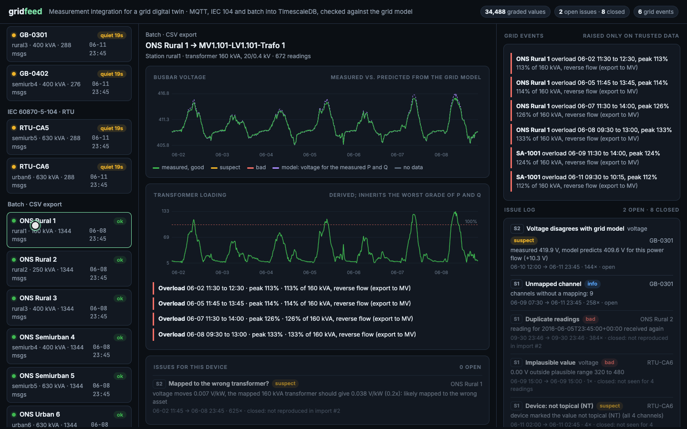
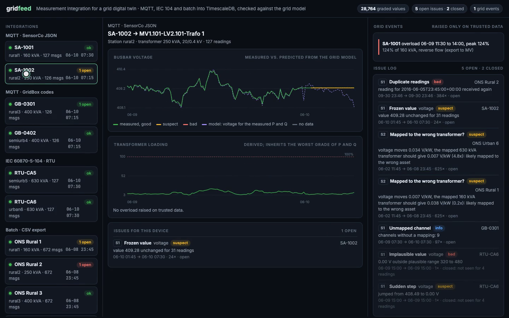
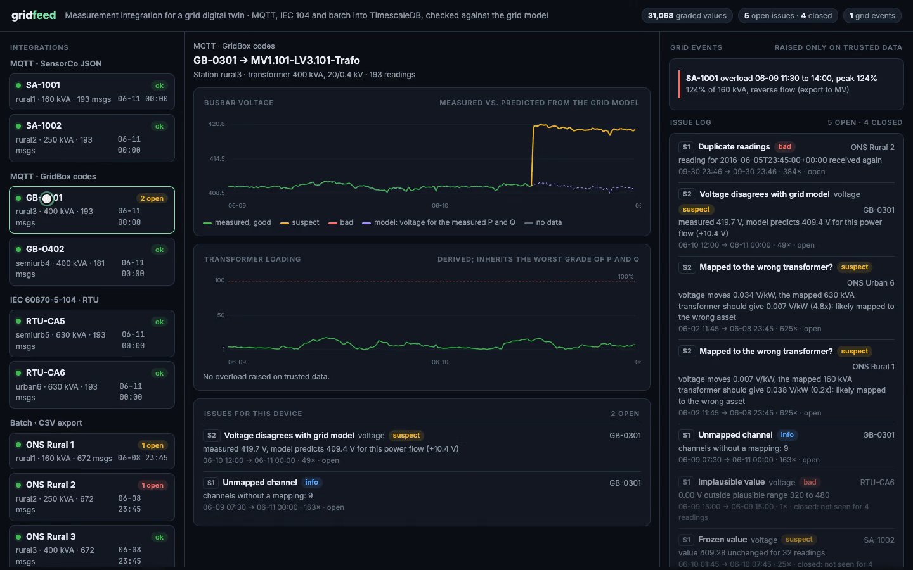
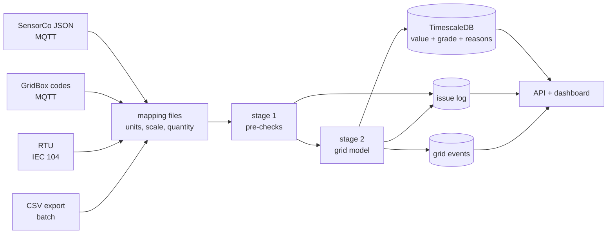

# gridfeed

Measurement integration for a grid digital twin. Substation sensors send data over MQTT (two vendors, two payload formats) and IEC 60870-5-104. Historical data arrives as a German CSV export. Every value goes through the same pipeline: a mapping file turns it into a measurement, two stages of checks grade it, and TimescaleDB stores the grade next to the value. An issue log records every problem and re-checks it on each new reading or import, and closes it once the source stops producing it.

The grid is real. Six low-voltage grids from [SimBench](https://simbench.de) (German benchmark grids, CC BY 4.0), each fed by one 20/0.4 kV substation. A load flow runs over their real 15-minute load and PV profiles, and the results are what the simulated sensors measure.


([MP4](assets/demo.mp4))

## What it catches

The simulator injects known faults. On a full run gridfeed reports each of them, and nothing else:

| Injected | Where | Reported as | Stage |
|---|---|---|---|
| Voltage sensor stuck for 8 hours | SA-1002, MQTT | frozen value, from the 8th identical reading | 1 |
| Gateway silent for 3 hours | GB-0402, MQTT | feed shown as quiet while silent, then 12 readings missing | 1 |
| Voltage sensor reads 2.5% high after maintenance | GB-0301, MQTT | "measured 419.9 V, model predicts 409.6 V for this power flow (+10.3 V)" | 2 |
| Firmware update adds a channel | GB-0301, MQTT | unmapped channel 9 | 1 |
| A 0 V reading | RTU-CA6, IEC 104 | implausible value, sudden step | 1 |
| RTU marks values not topical | RTU-CA6, IEC 104 | device quality flag NT, values graded suspect | 1 |
| Two stations swapped in the export | batch CSV | mapped to the wrong transformer (0.2x and 4.8x the expected voltage sensitivity) | 2 |
| One day exported twice | batch CSV | duplicate readings | 1 |

And one real grid finding, not a fault: in SimBench's 2034 scenario the 160 kVA transformer of the rural1 grid exports up to 124% of its rating at midday PV peaks. gridfeed raises overload events only when the inputs are trusted.

The batch run shows why that matters. With two stations swapped in the export, the four historical overloads at rural1 are invisible: its data sits on a 630 kVA transformer. When the customer sends a corrected export, the mapping issues close ("not reproduced in import #2") and the four overloads (113% to 133%) appear.



| Frozen sensor | Calibration drift |
|---|---|
|  |  |

## How it works



**Mapping as configuration.** `mappings/*.yaml` says which field is which quantity, in which unit and scale: named JSON readings in kW, numeric channel codes with integer raw values, IEC 104 information object addresses, CSV columns with decimal commas. `config/devices.yaml` says which device measures which asset in the grid model. Connecting a new device type means a new mapping file and a golden test against a recorded raw message (`tests/fixtures/raw_messages.json`), not new code.

**Stage 1, pre-checks** (`gridfeed/checks.py`), no grid model needed: the device's own quality bits (IEC 104 IV, NT), physical plausibility, frozen values, sudden steps, gaps, duplicates and time order, and whether every expected channel arrived.

**Stage 2, against the grid model:**
- The mapped asset exists and the voltage level fits.
- **Model voltage.** The busbar voltage the transformer's impedance predicts for the measured P and Q (du = r·p + x·q), compared with the measured voltage. Against a full load flow this approximation is within 0.8 V at 124% loading, and the tolerance is 1.5% (6 V), so a 2.5% calibration offset stands out.
- **Current consistency.** Measured current against P, Q and U.
- **Voltage fingerprint.** How much the busbar voltage moves per kW, fitted by least squares from the device's own data and compared with the mapped transformer. A 160 kVA transformer's voltage moves about five times more per kW than a 630 kVA one's, so a device mapped to the wrong asset shows up even when every single reading looks plausible. Only readings that agree with the model feed the fit, so a calibration offset is reported as an offset and not as a mapping error.
- **Derived values.** Apparent power and transformer loading inherit the worst grade of their inputs. Overload events are raised only on good data. On suspect data the tool says it computed an overload and did not raise it.

**Issue log** (`gridfeed/pipeline.py`). One row per device, check and quantity, with first and last seen, occurrences and the latest detail. Live feeds close an issue after four clean readings. Batch imports close issues from earlier imports that the new file no longer reproduces, and record each run in `import_run`.

**Storage.** A TimescaleDB hypertable keyed on device, quantity and time, so re-importing a period replaces it instead of duplicating it.

## IEC 60870-5-104

`gridfeed/iec104.py` is a small implementation in plain Python, written for this project. It covers:
- APCI framing (I, S and U frames);
- send and receive sequence numbers, with acknowledgement after 8 frames or when idle;
- STARTDT and TESTFR;
- station interrogation;
- measured short floats with and without CP56Time2a time tags, including the quality descriptor.

It also includes a simulated RTU.

It is checked against [c104](https://github.com/Fraunhofer-FIT-DIEN/iec104-python) (Fraunhofer FIT), an independent implementation, running in Docker. gridfeed's client connects, starts data transfer, interrogates station 5 and decodes both the interrogation replies (cause 20) and spontaneous values (cause 3) with their timestamps:

```bash
docker run -d --name c104ref -p 2405:2404 -v "$PWD/tests/interop:/app" python:3.12-slim sh -c "pip install -q c104 && python /app/c104_server.py"
PYTHONPATH=. .venv/bin/python tests/interop/check_client.py 127.0.0.1 2405
```

Not covered: commands other than interrogation, file transfer, redundancy groups, and IEC 62351 security.

## Run

```bash
uv venv .venv --python 3.12 && uv pip install --python .venv/bin/python -r requirements.txt
cd infra && docker compose up -d && cd ..          # Mosquitto on 1883, TimescaleDB on 5433
.venv/bin/python -m gridfeed.ingest --reset        # terminal 1: MQTT + IEC 104 into the pipeline
.venv/bin/uvicorn gridfeed.api:app --port 8020     # terminal 2: dashboard on http://localhost:8020
.venv/bin/python -m gridfeed.sim --interval 0.5    # terminal 3: six substations, three days, with faults

.venv/bin/python -m gridfeed.backfill export data/exports/week_v1.csv --swap "ONS Rural 1" "ONS Urban 6" --duplicate-day
.venv/bin/python -m gridfeed.backfill import data/exports/week_v1.csv
.venv/bin/python -m gridfeed.backfill export data/exports/week_v2.csv
.venv/bin/python -m gridfeed.backfill import data/exports/week_v2.csv
```

The load-flow results are in `data/profiles/`. To regenerate them from SimBench: `python -m gridfeed.generate` (about two minutes).

Tests: `.venv/bin/python -m pytest -q`. They cover golden mapping tests per source, stage 1 and 2 checks, the fingerprint, IEC 104 framing and a full RTU-to-client loop over TCP.

## Data

- SimBench LV grids `1-LV-rural2/rural3/semiurb4/semiurb5/urban6--0-sw` (today) and `1-LV-rural1--2-sw` (2034 scenario, more PV). Data: simbench.de, CC BY 4.0.
- The 2034 scenario includes home batteries. Their profile's sign convention was not clear from the data, so they are switched off rather than guessed. The rural1 overload is therefore "2034 PV without batteries".
- Load flow with pandapower. Sensor noise is added in the simulator. Faults are injected on top and listed in `gridfeed/sim.py`.

## Limits

- **Fingerprint:** it cannot tell apart two identical transformers (a swap between the two 400 kVA stations gives 0.95x). It also needs enough variation in power to fit.
- **Model:** the voltage check uses the transformer only. The MV-side voltage is taken as the grid's setpoint, not measured.
- **Scale:** one process, no broker between devices and pipeline. At scale a log such as Kafka would sit there so that ingestion and checking can scale and replay independently. The batch path writes with `executemany`; `COPY` would be the next step for large files.
- **MQTT:** QoS 1 without persistent sessions, so messages sent while the ingestor is down are lost.
- **Faults:** everything is simulated on real grid data, and the faults are injected, not observed.

Not affiliated with any grid operator, vendor or SimBench.
